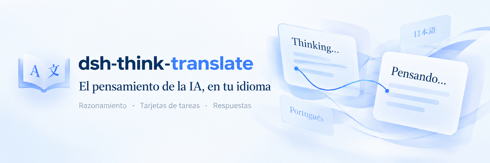
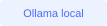
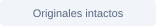
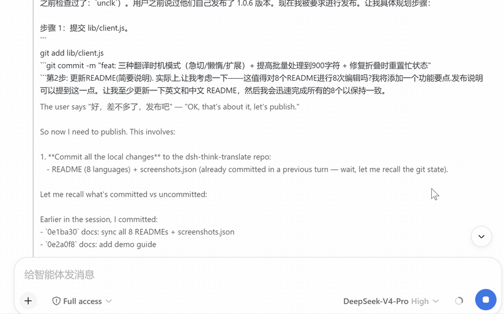
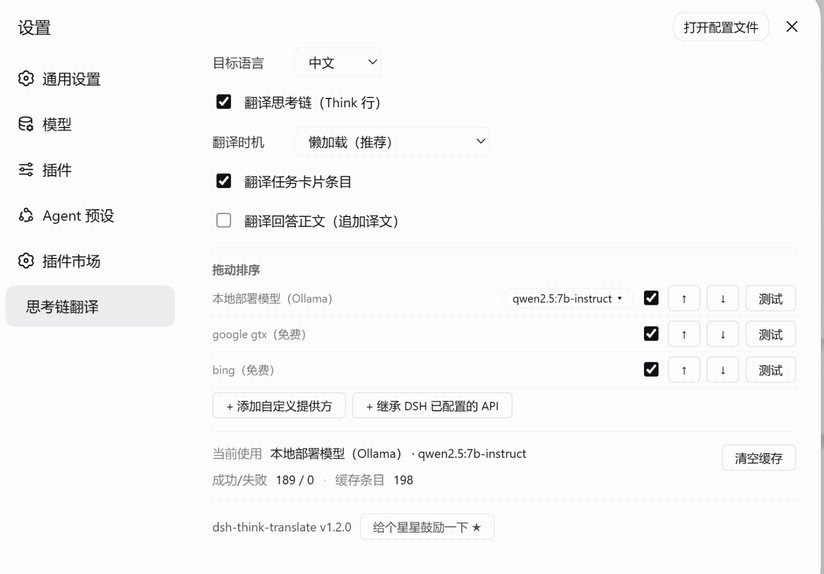
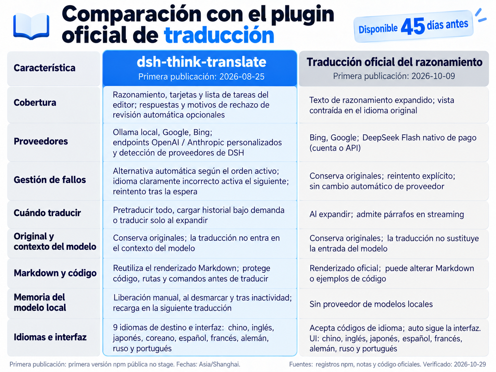

<p align="center">
  
</p>

<p align="center">
  <b>Traducción de la capa visual para DeepSeek Harness.</b><br />
  Lee el razonamiento, sigue las tareas y comprende las respuestas. Conserva los originales; la traducción no entra en el contexto del modelo.
</p>

<p align="center">
  
  
  
</p>

<p align="center">
  <a href="README.zh-CN.md">中文</a> · <a href="README.md">English</a> · <a href="README.ja.md">日本語</a> · <a href="README.ko.md">한국어</a> · <b>Español</b> · <a href="README.fr.md">Français</a> · <a href="README.de.md">Deutsch</a> · <a href="README.ru.md">Русский</a> · <a href="README.pt.md">Português</a>
</p>

<p align="center">
  <a href="#quick-start"></a> &nbsp;·&nbsp; <a href="#demo"></a> &nbsp;·&nbsp; <a href="#features"></a> &nbsp;·&nbsp; <a href="#comparison"></a> &nbsp;·&nbsp; <a href="#faq"></a>
</p>

---

<a id="demo"></a>
## Ve cómo surge el pensamiento

<table>
<tr>
<td width="50%" align="center" valign="bottom">

</td>
<td width="50%" align="center" valign="bottom">

</td>
</tr>
<tr>
<td align="center" valign="top"><sub>Demo 1 · Razonamiento y respuestas</sub></td>
<td align="center" valign="top"><sub>Demo 2 · Más operaciones</sub></td>
</tr>
</table>

<a id="comparison"></a>
## Comparación con el plugin oficial de traducción

<p align="center">
  
</p>

Activa este plugin o el traductor oficial de razonamiento. Ambos controlan la interfaz del razonamiento.

<a id="quick-start"></a>
## Un comando para empezar

```bash
dsh plugin --profile web add dsh-think-translate
```

Tras instalar, reinicia completamente DSH Web. Abre **Ajustes → Traducción del pensamiento** y elige el idioma y los proveedores. Activa **Mostrar la traducción en la barra lateral** para fijar los controles de traducción junto a los demás paneles globales. La página agrupa preferencias, servicios y actividad de traducción en tarjetas, con un diseño de una sola columna en ventanas estrechas. El diálogo de ajustes usa secciones compactas de una sola columna con los mismos controles. La elección se guarda en este navegador y se conserva tras actualizar la página o reiniciar DSH; desactívala en el diálogo de ajustes o en la página de traducción para quitar el acceso.

<details>
<summary><b>Instalar desde GitHub, actualizar y otros métodos</b></summary>

Instalar desde GitHub:

```bash
dsh plugin --profile web add github:UncleK/dsh-think-translate
```

Actualizar desde npm:

```bash
dsh plugin --profile web add dsh-think-translate@latest
```

Reinicia DSH por completo después de instalar o actualizar. Para una instalación manual, enlaza el paquete al perfil y regístralo en `cordis.patch.yml`. Para el uso normal, se recomiendan los comandos anteriores.

</details>

<a id="features"></a>
## Hay más que razonamiento por entender

<table>
<tr>
<td width="50%" valign="top">
<h3>Razonamiento en directo</h3>
<p>Pretraducir todo, cargar historial bajo demanda o traducir solo al expandir</p>
</td>
<td width="50%" valign="top">
<h3>Tareas y respuestas juntas</h3>
<p>Razonamiento, tarjetas y lista de tareas del editor; respuestas y motivos de rechazo de revisión automática opcionales</p>
</td>
</tr>
<tr>
<td width="50%" valign="top">
<h3>Entiende las decisiones de revisión</h3>
<p>Si la revisión automática rechaza una llamada, su motivo aparece traducido junto al original. Los botones de decisión existentes siguen disponibles.</p>
</td>
<td width="50%" valign="top">
<h3>Conserva originales y código</h3>
<p>Conserva originales; la traducción no entra en el contexto del modelo. Reutiliza el renderizado Markdown; protege código, rutas y comandos antes de traducir.</p>
</td>
</tr>
<tr>
<td width="50%" valign="top">
<h3>Modelos locales bajo demanda</h3>
<p>Liberación manual, al desmarcar y tras inactividad; recarga en la siguiente traducción</p>
</td>
<td width="50%" valign="top">
<h3>Proveedores en tu orden</h3>
<p>Alternativa automática según el orden activo; idioma claramente incorrecto activa el siguiente; reintento tras la espera</p>
</td>
</tr>
</table>

### Conecta los proveedores que ya usas

**Ollama · Google · Bing · OpenAI · Anthropic Messages API**

Detecta proveedores configurados en DSH sin volver a introducir endpoints y claves. Prueba cada fila por separado; el orden de la lista controla los intentos.

```text
Tu primera opción → siguiente proveedor activo → … → original si todos fallan
```

<details>
<summary><b>Endpoints personalizados, credenciales y recuperación</b></summary>

- Admite `/v1/chat/completions` compatible con OpenAI y la API nativa Anthropic Messages.
- Detecta proveedores del perfil DSH actual y sus modificaciones; vuelve a explorar y añádelos a la cadena.
- `apiKeyEnv` se resuelve al solicitar; la credencial resuelta no se guarda en la configuración.
- Los fallos esperan 30 segundos en la memoria del host antes de nuevos intentos. Un idioma claramente incorrecto activa el siguiente proveedor.
- La detección omite texto reconocido en el idioma de destino; las pruebas de proveedor siempre hacen una solicitud real.

</details>

### Glosario: términos coherentes

El glosario integrado y las entradas propias tienen casillas independientes en sus secciones y se aplican al instante sin borrar texto al desactivarlas. El integrado, opcional, incluye 60 términos ingleses de IA, programación y productos para nueve idiomas. Las entradas propias activadas tienen prioridad y 128 espacios adicionales. Los cambios sin guardar resaltan Guardar y muestran avisos de otros idiomas. Las pantallas anchas usan paneles lado a lado y estado horizontal; ventanas estrechas y diálogos, una columna.

Cada idioma de destino tiene su propio glosario en ajustes y en la página lateral de traducción. Introduce un original => traducción por línea y guarda. Usar el mismo texto a ambos lados conserva un nombre de producto.

```text
DeepSeek => DeepSeek
agent => agente
reasoning => razonamiento
```

Las palabras inglesas se comparan completas sin distinguir mayúsculas; los términos largos tienen prioridad. Código, rutas y comandos se conservan. Máximo 128 entradas por idioma. Guardar invalida traducciones antiguas; desactivar conserva las entradas. Se aplica al texto enviado a traducir, sin modificar el original.

### Modelos locales de traducción: carga y liberación bajo demanda

| Tu acción | Comportamiento |
|---|---|
| Traducir o probar | Inicia el servicio y carga el modelo seleccionado bajo demanda |
| Liberar memoria del modelo | Espera las traducciones activas y libera; conserva archivos, interruptores y orden |
| Desmarcar el proveedor local | Lo desactiva y libera el modelo seleccionado |
| Reactivarlo o abrir ajustes | No precarga; carga en la próxima traducción real |
| Configurar liberación por inactividad | 5 minutos por defecto; 1 / 5 / 10 / 30 / 60 minutos o desactivada |

El plazo se aplica desde el próximo uso. Ollama controla el modelo seleccionado sin cambiar variables globales. El software o los modelos faltantes solo se instalan o descargan al pulsar preparar, mostrando el progreso.

<a id="languages"></a>
### Tu idioma te acompaña

中文 · English · 日本語 · 한국어 · Español · Français · Deutsch · Русский · Português

Nueve idiomas de destino, ajustes y textos de tareas, incluido el portugués. La selección se conserva al recargar.

<a id="faq"></a>
## Respuestas a preguntas frecuentes

<details>
<summary><b>No aparece la opción de traducción tras instalar o actualizar</b></summary>

Reinicia completamente `dsh web`. El grafo de módulos se monta al iniciar el proceso; recargar la página puede no bastar. El pie de ajustes muestra la versión instalada.

</details>

<details>
<summary><b>La lista de modelos locales está vacía</b></summary>

Comprueba `ollama list` o `/api/tags`, el directorio activo y `OLLAMA_MODELS` del servicio. No hace falta volver a descargar archivos existentes.

</details>

<details>
<summary><b>Aparece client bundles not found después de actualizar DSH</b></summary>

Ejecuta `pnpm run build` en el repositorio de DeepSeek Harness y reinicia DSH Web.

</details>

<details>
<summary><b>¿Un fallo de traducción afecta a la conversación?</b></summary>

Si todos los proveedores activos fallan, se conserva el original. Prueba cada proveedor y consulta el último error en ajustes. Las solicitudes posteriores pueden reintentarlo tras la espera.

</details>

<details>
<summary><b>Cambios recientes y compatibilidad</b></summary>

**1.2.21** Corrige las solicitudes repetidas de traducción al actualizar tareas rápidamente (#17). El texto se traduce tras 500 ms sin cambios.

**1.2.20** añade un glosario técnico opcional de un clic con 60 términos y productos para los nueve idiomas. Las entradas propias tienen prioridad y límite independiente; permite consultar y desactivar sin borrarlas.

**1.2.19** añade glosarios por idioma, credenciales de DSH, cachés por configuración, exclusión con el complemento oficial, mayor protección técnica y CI de Windows/Linux.

**1.2.18** añade una entrada persistente en la barra lateral para los controles de traducción (se activa en los ajustes o en la página de traducción y se guarda por navegador) y rediseña la página de traducción y el diálogo de ajustes en secciones tipo tarjeta con un diseño adaptable de una sola columna en ventanas estrechas.

**1.2.17** corrige el cambio del plazo de inactividad en modelos Ollama ya cargados, permite hasta 120 segundos de inferencia local y muestra el tiempo restante. Resuelve los problemas reproducibles del issue #17; el aumento de memoria a largo plazo sigue en investigación.

**1.2.16** añade portugués al destino y la interfaz, renueva los nueve README e imágenes localizadas y declara tres imágenes para el mercado.

**1.2.15** añade gestión de memoria local y adapta imágenes, plegado de razonamiento y selección del original a DSH `0.2.2-alpha.2`.

Más versiones: [GitHub Releases](https://github.com/UncleK/dsh-think-translate/releases).

</details>

<details>
<summary><b>Desarrollo y funcionamiento</b></summary>

- `lib/index.js`: rutas del host, proveedores, configuración, caché y modelos locales.
- `lib/client.js`: ajustes, traducción visual, lotes en streaming y caché del navegador.
- `lib/config.json`: configuración en ejecución, excluida de Git y npm.
- Sin compilación adicional: el código es el producto. Reinicia DSH tras cambiar el host.
- Verifica con `npm test`. Detección y credenciales: [notas de mantenimiento](https://github.com/UncleK/dsh-think-translate/blob/main/docs/maintenance-notes.md).

</details>

---

<p align="center">
  <b>dsh-think-translate</b><br />
  <a href="https://github.com/UncleK/dsh-think-translate/issues">Informar de un problema</a> &nbsp;·&nbsp; <a href="https://github.com/UncleK/dsh-think-translate/releases">Versiones</a> &nbsp;·&nbsp; <a href="https://github.com/UncleK/dsh-think-translate/blob/main/LICENSE">Licencia MIT</a>
</p>
