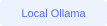
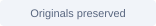
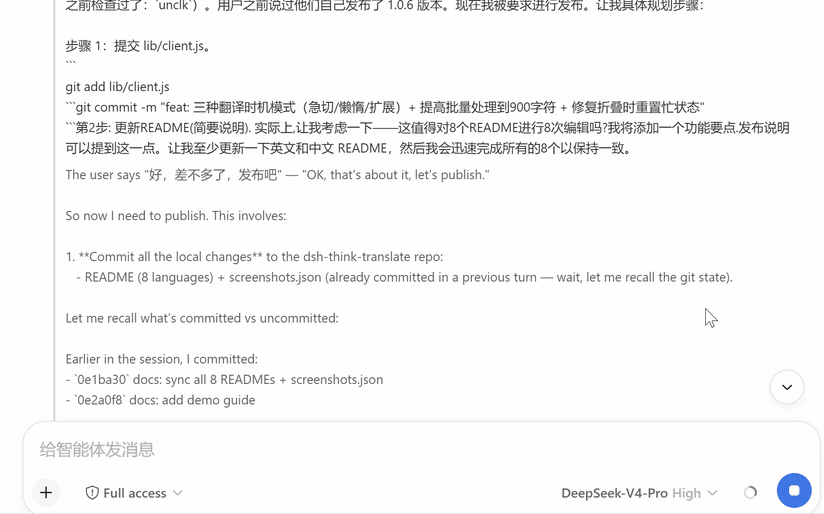
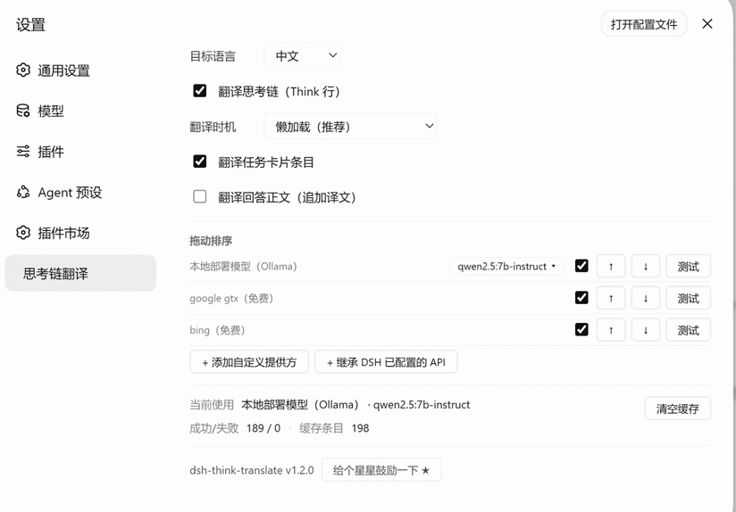
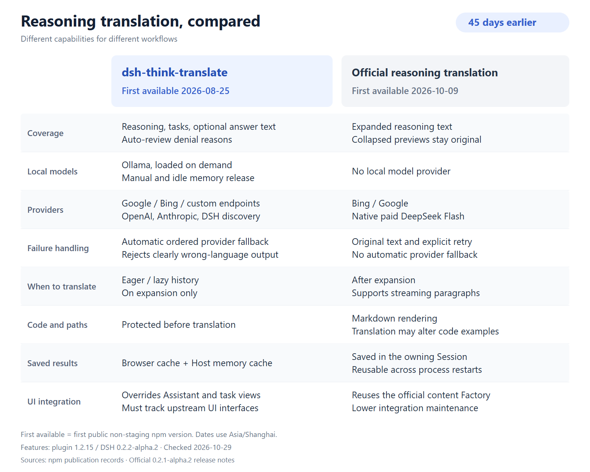

<p align="center">
  
</p>

<p align="center">
  <b>Display-layer translation for DeepSeek Harness.</b><br />
  Read the reasoning, follow the tasks, and understand the answers. Originals are preserved; translations stay out of model context.
</p>

<p align="center">
  
  
  
</p>

<p align="center">
  <a href="README.zh-CN.md">中文</a> · <b>English</b> · <a href="README.ja.md">日本語</a> · <a href="README.ko.md">한국어</a> · <a href="README.es.md">Español</a> · <a href="README.fr.md">Français</a> · <a href="README.de.md">Deutsch</a> · <a href="README.ru.md">Русский</a> · <a href="README.pt.md">Português</a>
</p>

<p align="center">
  <a href="#quick-start"></a> &nbsp;·&nbsp; <a href="#demo"></a> &nbsp;·&nbsp; <a href="#features"></a> &nbsp;·&nbsp; <a href="#comparison"></a> &nbsp;·&nbsp; <a href="#faq"></a>
</p>

---

<a id="demo"></a>
## See thinking unfold

<table>
<tr>
<td width="50%" align="center" valign="bottom">

</td>
<td width="50%" align="center" valign="bottom">

</td>
</tr>
<tr>
<td align="center" valign="top"><sub>Demo 1 · Reasoning and answers</sub></td>
<td align="center" valign="top"><sub>Demo 2 · More live operations</sub></td>
</tr>
</table>

<a id="comparison"></a>
## Comparison with the official translation plugin

<p align="center">
  
</p>

Enable either this plugin or the official reasoning translator. Both take over the reasoning interface. While the official plugin is enabled, this plugin yields its translation views and displays a conflict notice. It resumes when the official plugin is disabled, without changing the official plugin's configuration.

<a id="quick-start"></a>
## One command to get started

```bash
dsh plugin --profile web add dsh-think-translate
```

After installation, fully restart DSH Web. Open **Settings → Think Translation**, then choose the target language and providers. Enable **Show translation in the sidebar** to pin the translation controls beside the other global panels. The page groups translation preferences, services and activity into cards, with a single-column layout in narrow windows. The settings dialog uses compact single-column sections with the same controls. The choice is saved in this browser and survives page refreshes and DSH restarts; switch it off in either the settings dialog or the translation page to remove the shortcut.

<details>
<summary><b>GitHub installation, updates and other methods</b></summary>

Install from GitHub:

```bash
dsh plugin --profile web add github:UncleK/dsh-think-translate
```

Update from npm:

**On the first update from 1.2.21 or earlier**, stop DSH and, inside the active profile directory, copy `node_modules/dsh-think-translate/lib/config.json` to `dsh-think-translate/config.json` (create the directory if needed). Keep the destination if it already exists. The plugin market may uninstall the old package first, so copy the file before updating. The new version keeps providers, glossaries and DSH credential references under the profile.

```bash
dsh plugin --profile web add dsh-think-translate@latest
```

Fully restart DSH after installing or updating. For manual deployment, link the package into the profile and add its entry to `cordis.patch.yml`; the commands above are recommended for everyday use.

</details>

<a id="features"></a>
## More than reasoning to understand

<table>
<tr>
<td width="50%" valign="top">
<h3>Reasoning, as it happens</h3>
<p>Pre-translate all, lazy-load history, or translate only when expanded</p>
</td>
<td width="50%" valign="top">
<h3>Tasks and answers, together</h3>
<p>Reasoning, task cards and composer task lists; optional answers and auto-review denial reasons</p>
</td>
</tr>
<tr>
<td width="50%" valign="top">
<h3>Understand review decisions</h3>
<p>When auto-review rejects a tool call, its reason is translated alongside the original. The existing decision buttons remain available.</p>
</td>
<td width="50%" valign="top">
<h3>Preserve originals and code</h3>
<p>Originals preserved; translations stay out of model context. Reuses Markdown rendering; protects code, paths and commands before translation.</p>
</td>
</tr>
<tr>
<td width="50%" valign="top">
<h3>Local models, loaded on demand</h3>
<p>Manual release, release when unchecked, idle auto-release; reloads on the next translation</p>
</td>
<td width="50%" valign="top">
<h3>Providers in your preferred order</h3>
<p>Automatic fallback in enabled order; clearly wrong-language output tries the next provider; retry after cooldown</p>
</td>
</tr>
</table>

### Connect providers you already use

**Ollama · Google · Bing · OpenAI · Anthropic Messages API**

Discover providers already configured in DSH without entering endpoints and keys again. Test each provider separately; list order controls the order of attempts.

```text
Your first choice → next enabled provider → … → originals if all fail
```

<details>
<summary><b>Custom endpoints, credentials and recovery</b></summary>

- Custom endpoints support OpenAI-compatible `/v1/chat/completions` and the native Anthropic Messages API.
- Discovery reads the current DSH profile and overrides. Rescan and add discovered providers to the translation chain.
- An `apiKeyEnv` key is resolved at request time; resolved credentials are never written back to plugin configuration.
- Manually entered keys are saved through DSH credentials; plugin configuration stores references only. Legacy literal keys migrate when that service is available. Unavailable storage rejects new literal-key saves; a failed migration retains the previous configuration.
- Configuration responses never contain saved key values. Leave an edited key field blank to retain it; explicitly select “Remove saved key” to delete it. DSH owns credential-file access protection; this is not OS-keychain encryption.
- Successful translations persist in the current browser, separated by provider, model and translation configuration. Configuration changes invalidate old results, including requests already in flight. Cache-version upgrades retain preferences.
- Failures cool down in host memory for 30 seconds, then subsequent translation requests can retry. Clearly wrong-language results try the next provider.
- Language detection skips text already recognized as the target language; explicit provider tests still make a real request.

</details>

### Glossary: consistent terms

The built-in glossary and custom entries have separate checkboxes in their own sections. Both apply immediately and independently; disabling either keeps your entries. The opt-in preset contains 60 common English AI/programming terms and product names for all nine target languages. Enabled custom terms override matching built-ins and retain 128 extra slots. Unsaved edits highlight Save and show reminders, including drafts in other languages. Wide pages use side-by-side preset/custom panes and horizontal status; narrow pages and dialogs stack them.

Each target language has its own glossary in settings and the sidebar translation page. Enter one source => translation pair per line and save. Using the same text on both sides preserves a product name.

```text
DeepSeek => DeepSeek
智能体 => AI agent
思考过程 => reasoning
```

English matches whole words without case sensitivity; longer terms take precedence. Code, paths and commands remain intact. Up to 128 entries per language. Saving invalidates old translations; disabling the glossary keeps your entries. Terms apply to prose actually submitted for translation, without rewriting the original.

### Local translation models: load and release on demand

| Your action | Plugin behavior |
|---|---|
| Translate or test | Start the service and load the selected model on demand |
| Release model memory | Wait for active translations, then unload; preserve files, switches and order |
| Uncheck the local provider | Disable it and unload the selected model |
| Re-enable it or open settings | No preload; load on the next actual translation |
| Set idle release | 5 minutes by default; choose 1 / 5 / 10 / 30 / 60 minutes or off |

Idle timing applies from the next use. Ollama tracks the selected model; global environment variables are unchanged. Missing software or models are installed or downloaded only after you click the preparation button, with progress shown.

<a id="languages"></a>
### Language settings that follow you

中文 · English · 日本語 · 한국어 · Español · Français · Deutsch · Русский · Português

Nine target languages, settings translations and task labels, including Portuguese. Your selection survives a page refresh.

<a id="faq"></a>
## Answers to common questions

<details>
<summary><b>No translation entry after installing or updating</b></summary>

Fully restart `dsh web`. The client module graph is assembled at process start; refreshing the page alone may not load a new plugin. The settings footer shows the installed package version.

</details>

<details>
<summary><b>The local model list is empty</b></summary>

Check `ollama list` or `/api/tags`, the active model directory, and the service’s `OLLAMA_MODELS`. Existing model files do not need to be downloaded again.

</details>

<details>
<summary><b>Source startup reports client bundles not found after a DSH update</b></summary>

Run `pnpm run build` in the DeepSeek Harness repository, then restart DSH Web.

</details>

<details>
<summary><b>Does a translation failure affect the conversation?</b></summary>

When all enabled providers fail, the original remains. Test individual providers and inspect the latest error in settings. Translation requests can retry after cooldown.

</details>

<details>
<summary><b>Recent changes and compatibility</b></summary>

**1.2.23** Restores translation for later reasoning blocks that start empty (#23), fixes todo dock icons (#24), and recognizes prose around common CJK slash expressions and file paths (#22).

**1.2.22** Stores translation settings under the DSH profile (#21) and fixes glossary fallback to shorter terms (#20). Follow the configuration copy step above when upgrading from an older version.

**1.2.21** Fixes repeated translation requests during rapid task updates (#17). Task text is translated after 500 ms without changes.

**1.2.20** adds an opt-in, one-click technical glossary with 60 terms and product names for all nine target languages. Custom entries override built-ins and retain their own allowance; preview and disable the preset without removing custom entries.

**1.2.19** adds per-language glossaries, DSH-managed credentials, configuration-aware caches, official-plugin mutual exclusion, stronger technical-text protection and Windows/Linux CI.

**1.2.18** adds a persistent sidebar entry for the translation controls (toggle in settings or the translation page, saved per browser) and redesigns the translation page and settings dialog into card-based sections with a responsive single-column layout in narrow windows.

**1.2.17** fixes idle-policy changes for already loaded Ollama models, allows up to 120 seconds for local inference, and displays the server idle countdown. Addresses reproducible parts of issue #17; long-term memory growth remains under investigation.

**1.2.16** adds Portuguese throughout the translation target and UI, refreshes all nine READMEs and localized comparison images, and declares three marketplace images.

**1.2.15** adds local model memory management and adapts to DSH `0.2.2-alpha.2` image rendering, grouped reasoning collapse and original text selection.

Earlier versions and details: [GitHub Releases](https://github.com/UncleK/dsh-think-translate/releases).

</details>

<details>
<summary><b>Development and internals</b></summary>

- `lib/index.js`: host routes, providers, configuration, memory cache and local model lifecycle.
- `lib/client.js`: settings, display-layer translation, streaming batches and browser cache.
- `lib/config.json`: runtime configuration, excluded from Git and npm.
- No extra build step: source files are the deliverable. Restart DSH after changing host code.
- Run checks with `npm test`. Discovery and credential handling are documented in the [maintenance notes](https://github.com/UncleK/dsh-think-translate/blob/main/docs/maintenance-notes.md).
- Push/PR CI runs `npm ci --ignore-scripts` and `npm test` on Windows/Linux with Node 20/22/24/26. Node 20 checks the declared compatibility floor; required merge checks need separate repository settings.
- Protection covers Markdown code, recognizable paths, URLs, filenames and common command fragments. Quote paths containing spaces; use backticks or fenced blocks for complex commands and ambiguous technical text. Separate a bare URL from adjacent CJK prose with backticks, whitespace or full-width punctuation.

</details>

---

<p align="center">
  <b>dsh-think-translate</b><br />
  <a href="https://github.com/UncleK/dsh-think-translate/issues">Report an issue</a> &nbsp;·&nbsp; <a href="https://github.com/UncleK/dsh-think-translate/releases">Releases</a> &nbsp;·&nbsp; <a href="https://github.com/UncleK/dsh-think-translate/blob/main/LICENSE">MIT License</a>
</p>
