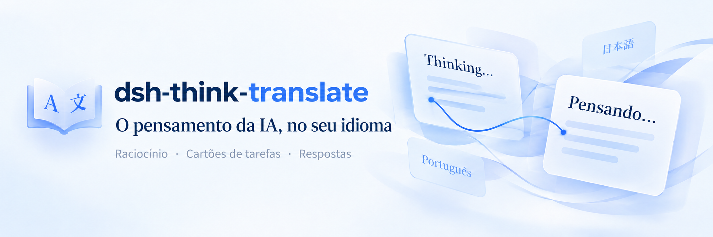
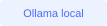
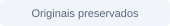
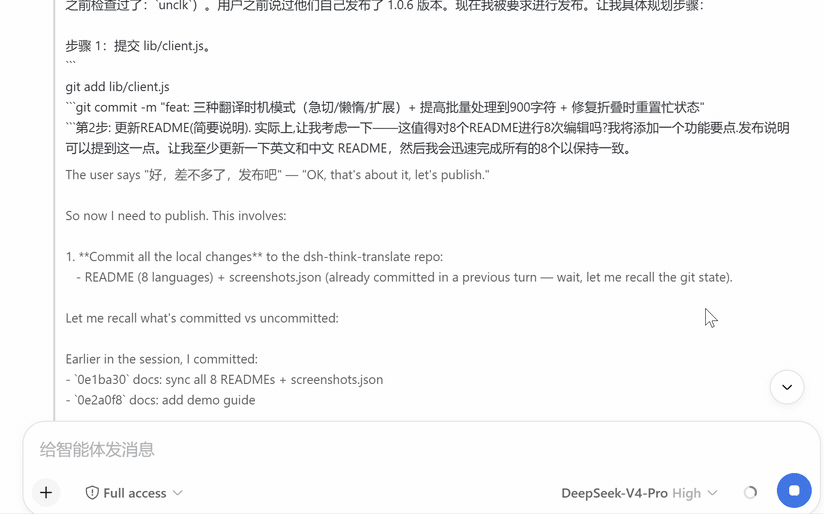
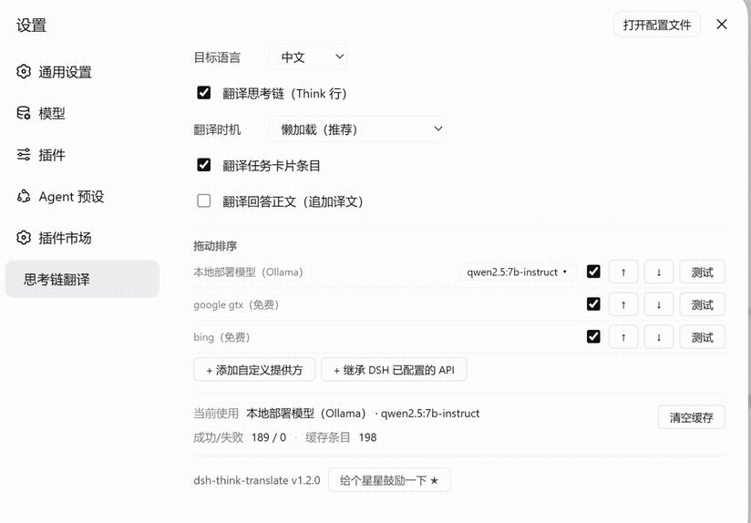
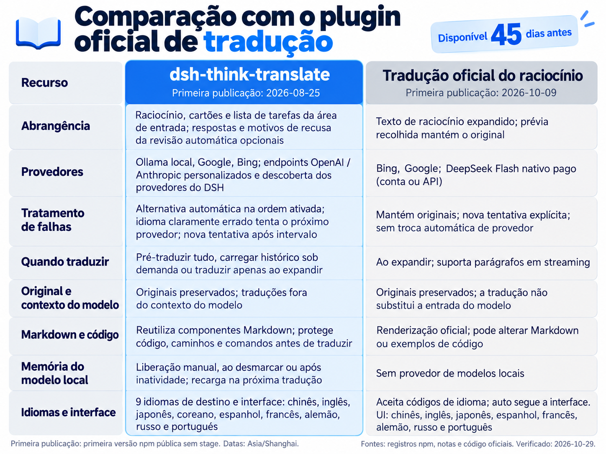

<p align="center">
  
</p>

<p align="center">
  <b>Tradução da camada de exibição do DeepSeek Harness.</b><br />
  Leia o raciocínio, acompanhe as tarefas e entenda as respostas. Os originais são preservados; as traduções ficam fora do contexto do modelo.
</p>

<p align="center">
  
  
  
</p>

<p align="center">
  <a href="README.zh-CN.md">中文</a> · <a href="README.md">English</a> · <a href="README.ja.md">日本語</a> · <a href="README.ko.md">한국어</a> · <a href="README.es.md">Español</a> · <a href="README.fr.md">Français</a> · <a href="README.de.md">Deutsch</a> · <a href="README.ru.md">Русский</a> · <b>Português</b>
</p>

<p align="center">
  <a href="#quick-start"></a> &nbsp;·&nbsp; <a href="#demo"></a> &nbsp;·&nbsp; <a href="#features"></a> &nbsp;·&nbsp; <a href="#comparison"></a> &nbsp;·&nbsp; <a href="#faq"></a>
</p>

---

<a id="demo"></a>
## Veja o pensamento acontecer

<table>
<tr>
<td width="50%" align="center" valign="bottom">

</td>
<td width="50%" align="center" valign="bottom">

</td>
</tr>
<tr>
<td align="center" valign="top"><sub>Demo 1 · Raciocínio e respostas</sub></td>
<td align="center" valign="top"><sub>Demo 2 · Mais operações</sub></td>
</tr>
</table>

<a id="comparison"></a>
## Comparação com o plugin oficial de tradução

<p align="center">
  
</p>

Ative este plugin ou o tradutor oficial de raciocínio. Ambos controlam a interface de raciocínio.

<a id="quick-start"></a>
## Um comando para começar

```bash
dsh plugin --profile web add dsh-think-translate
```

Após instalar, reinicie completamente o DSH Web. Abra **Configurações → Tradução do pensamento** e escolha o idioma de destino e os provedores. Ative **Mostrar a tradução na barra lateral** para fixar os controles de tradução ao lado dos demais painéis globais. A página agrupa preferências, serviços e atividade de tradução em cartões, com layout de coluna única em janelas estreitas. A caixa de diálogo de configurações usa seções compactas de coluna única com os mesmos controles. A escolha é salva neste navegador e permanece após atualizar a página ou reiniciar o DSH; desative-a na caixa de diálogo ou na página de tradução para remover o atalho.

<details>
<summary><b>Instalação pelo GitHub, atualizações e outros métodos</b></summary>

Instalar pelo GitHub:

```bash
dsh plugin --profile web add github:UncleK/dsh-think-translate
```

Atualizar pelo npm:

```bash
dsh plugin --profile web add dsh-think-translate@latest
```

Reinicie o DSH completamente após instalar ou atualizar. Na implantação manual, vincule o pacote ao perfil e adicione sua entrada em `cordis.patch.yml`. Para uso normal, recomendamos os comandos acima.

</details>

<a id="features"></a>
## Há mais que raciocínio para entender

<table>
<tr>
<td width="50%" valign="top">
<h3>Raciocínio em tempo real</h3>
<p>Pré-traduzir tudo, carregar histórico sob demanda ou traduzir apenas ao expandir</p>
</td>
<td width="50%" valign="top">
<h3>Tarefas e respostas juntas</h3>
<p>Raciocínio, cartões e lista de tarefas da área de entrada; respostas e motivos de recusa da revisão automática opcionais</p>
</td>
</tr>
<tr>
<td width="50%" valign="top">
<h3>Entenda as decisões de revisão</h3>
<p>Quando a revisão automática recusa uma chamada de ferramenta, o motivo aparece traduzido ao lado do original. Os botões de decisão existentes continuam disponíveis.</p>
</td>
<td width="50%" valign="top">
<h3>Preserve originais e código</h3>
<p>Originais preservados; traduções fora do contexto do modelo. Reutiliza componentes Markdown; protege código, caminhos e comandos antes de traduzir.</p>
</td>
</tr>
<tr>
<td width="50%" valign="top">
<h3>Modelos locais sob demanda</h3>
<p>Liberação manual, ao desmarcar ou após inatividade; recarga na próxima tradução</p>
</td>
<td width="50%" valign="top">
<h3>Provedores na sua ordem</h3>
<p>Alternativa automática na ordem ativada; idioma claramente errado tenta o próximo provedor; nova tentativa após intervalo</p>
</td>
</tr>
</table>

### Conecte os provedores que você já usa

**Ollama · Google · Bing · OpenAI · Anthropic Messages API**

Descubra provedores configurados no DSH sem digitar endpoints e chaves novamente. Teste cada linha separadamente; a ordem da lista define a sequência de tentativas.

```text
Sua primeira opção → próximo provedor ativado → … → original se todos falharem
```

<details>
<summary><b>Endpoints personalizados, credenciais e recuperação</b></summary>

- Suporta `/v1/chat/completions` compatível com OpenAI e a API nativa Anthropic Messages.
- A descoberta lê o perfil DSH atual e suas substituições. Verifique novamente e adicione provedores à sequência de tradução.
- `apiKeyEnv` é resolvido no momento da requisição; as credenciais resolvidas nunca são gravadas na configuração do plugin.
- Falhas aguardam 30 segundos na memória do host antes de novas tentativas. Um idioma claramente errado aciona o próximo provedor.
- A detecção ignora textos reconhecidos no idioma de destino; testes de provedor sempre enviam uma requisição real.

</details>

### Glossário: termos consistentes

O glossário integrado e suas entradas têm caixas independentes em suas seções e aplicação imediata, sem apagar texto ao desativar. A lista opcional contém 60 termos ingleses de IA, programação e produtos para nove idiomas. Seus termos ativos têm prioridade e 128 espaços extras. Edições não salvas destacam Salvar e lembram dos rascunhos em outros idiomas. Páginas largas usam painéis lado a lado e status horizontal; páginas estreitas e diálogos usam uma coluna.

Cada idioma de destino tem seu glossário nas configurações e na página lateral de tradução. Insira um original => tradução por linha e salve. O mesmo texto dos dois lados preserva um nome de produto.

```text
DeepSeek => DeepSeek
agent => agente
reasoning => raciocínio
```

Palavras inglesas correspondem inteiras sem distinguir maiúsculas; termos longos têm prioridade. Código, caminhos e comandos permanecem intactos. Até 128 entradas por idioma. Salvar invalida traduções antigas; desativar mantém as entradas. Aplica-se apenas ao texto enviado para tradução, sem alterar o original.

### Modelos locais de tradução: carregar e liberar sob demanda

| Sua ação | Comportamento do plugin |
|---|---|
| Traduzir ou testar | Inicia o serviço e carrega o modelo selecionado sob demanda |
| Liberar memória do modelo | Aguarda traduções ativas e libera; mantém arquivos, opções e ordem |
| Desmarcar o provedor local | Desativa e libera o modelo selecionado |
| Reativar ou abrir configurações | Sem pré-carregamento; carrega na próxima tradução real |
| Configurar liberação por inatividade | 5 minutos por padrão; 1 / 5 / 10 / 30 / 60 minutos ou desativada |

O prazo vale a partir do próximo uso. O Ollama acompanha o modelo selecionado sem alterar variáveis globais. Softwares ou modelos ausentes só são instalados ou baixados após clicar em preparar, com progresso visível.

<a id="languages"></a>
### Seu idioma acompanha você

中文 · English · 日本語 · 한국어 · Español · Français · Deutsch · Русский · Português

Nove idiomas de destino, configurações e tarefas, incluindo português. A seleção é preservada ao atualizar a página.

<a id="faq"></a>
## Respostas às perguntas frequentes

<details>
<summary><b>A opção de tradução não aparece após instalar ou atualizar</b></summary>

Reinicie completamente `dsh web`. O grafo de módulos é montado no início do processo; atualizar só a página pode não bastar. O rodapé das configurações mostra a versão instalada.

</details>

<details>
<summary><b>A lista de modelos locais está vazia</b></summary>

Confira `ollama list` ou `/api/tags`, o diretório ativo e `OLLAMA_MODELS` do serviço. Não é necessário baixar novamente arquivos existentes.

</details>

<details>
<summary><b>Client bundles not found após atualizar o DSH</b></summary>

Execute `pnpm run build` no repositório DeepSeek Harness e reinicie o DSH Web.

</details>

<details>
<summary><b>Uma falha de tradução afeta a conversa?</b></summary>

Se todos os provedores ativados falharem, o original permanece. Teste cada provedor e consulte o último erro nas configurações. As próximas requisições podem tentar novamente após o intervalo.

</details>

<details>
<summary><b>Atualizações e compatibilidade</b></summary>

**1.2.21** Corrige solicitações repetidas de tradução quando as tarefas mudam rapidamente (#17). O texto é traduzido após 500 ms sem alterações.

**1.2.20** adiciona um glossário técnico opcional de um clique com 60 termos e produtos nos nove idiomas. Suas entradas têm prioridade e limite independente; é possível consultar e desativar sem removê-las.

**1.2.19** adiciona glossários por idioma, credenciais gerenciadas pelo DSH, caches por configuração, exclusão com o plugin oficial, proteção técnica reforçada e CI Windows/Linux.

**1.2.18** adiciona uma entrada persistente na barra lateral para os controles de tradução (ativada nas configurações ou na página de tradução, salva por navegador) e reformula a página de tradução e a caixa de diálogo de configurações em seções em cartão, com layout responsivo de coluna única em janelas estreitas.

**1.2.17** aplica o prazo salvo a modelos Ollama já carregados, aguarda até 120 segundos pela inferência local e mostra o tempo restante. Corrige os problemas reproduzíveis do issue #17; o aumento de memória a longo prazo continua em investigação.

**1.2.16** adiciona português ao destino e à interface, renova os nove README e imagens localizadas, e declara três imagens para o mercado.

**1.2.15** adiciona gestão de memória local e adapta imagens, recolhimento agrupado do raciocínio e seleção do original ao DSH `0.2.2-alpha.2`.

Versões anteriores: [GitHub Releases](https://github.com/UncleK/dsh-think-translate/releases).

</details>

<details>
<summary><b>Desenvolvimento e funcionamento</b></summary>

- `lib/index.js`: rotas do host, provedores, configuração, cache e modelos locais.
- `lib/client.js`: configurações, tradução da exibição, lotes em streaming e cache do navegador.
- `lib/config.json`: configuração de execução, excluída do Git e npm.
- Sem compilação extra: os fontes são o produto. Reinicie o DSH após mudar o host.
- Verifique com `npm test`. Descoberta e credenciais: [notas de manutenção](https://github.com/UncleK/dsh-think-translate/blob/main/docs/maintenance-notes.md).

</details>

---

<p align="center">
  <b>dsh-think-translate</b><br />
  <a href="https://github.com/UncleK/dsh-think-translate/issues">Relatar um problema</a> &nbsp;·&nbsp; <a href="https://github.com/UncleK/dsh-think-translate/releases">Versões</a> &nbsp;·&nbsp; <a href="https://github.com/UncleK/dsh-think-translate/blob/main/LICENSE">Licença MIT</a>
</p>
