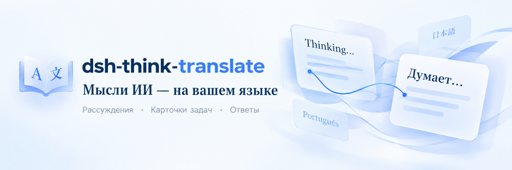
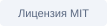
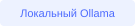
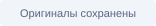
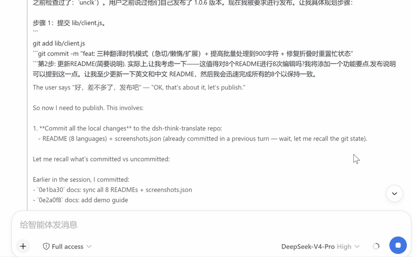
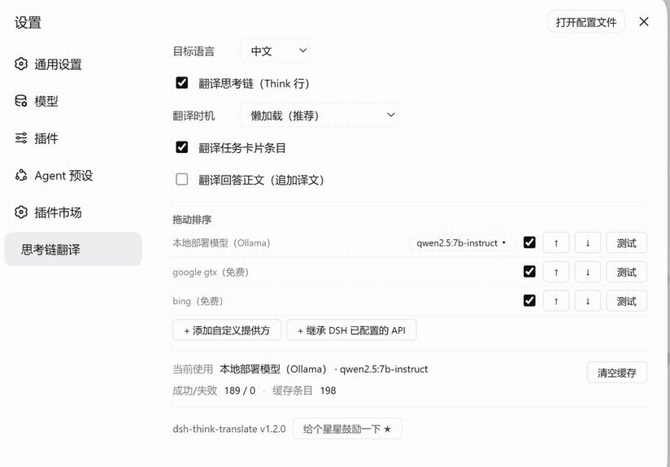
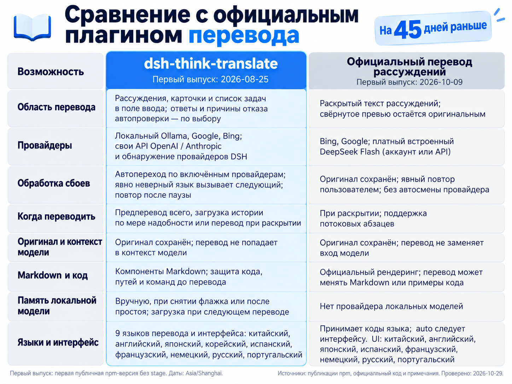

<p align="center">
  
</p>

<p align="center">
  <b>Перевод слоя отображения для DeepSeek Harness.</b><br />
  Читайте рассуждения, следите за задачами и понимайте ответы. Оригиналы сохранены; переводы не входят в контекст модели.
</p>

<p align="center">
  
  
  
</p>

<p align="center">
  <a href="README.zh-CN.md">中文</a> · <a href="README.md">English</a> · <a href="README.ja.md">日本語</a> · <a href="README.ko.md">한국어</a> · <a href="README.es.md">Español</a> · <a href="README.fr.md">Français</a> · <a href="README.de.md">Deutsch</a> · <b>Русский</b> · <a href="README.pt.md">Português</a>
</p>

<p align="center">
  <a href="#quick-start"></a> &nbsp;·&nbsp; <a href="#demo"></a> &nbsp;·&nbsp; <a href="#features"></a> &nbsp;·&nbsp; <a href="#comparison"></a> &nbsp;·&nbsp; <a href="#faq"></a>
</p>

---

<a id="demo"></a>
## Наблюдайте, как рождаются мысли

<table>
<tr>
<td width="50%" align="center" valign="bottom">

</td>
<td width="50%" align="center" valign="bottom">

</td>
</tr>
<tr>
<td align="center" valign="top"><sub>Демо 1 · Рассуждения и ответы</sub></td>
<td align="center" valign="top"><sub>Демо 2 · Другие операции</sub></td>
</tr>
</table>

<a id="comparison"></a>
## Сравнение с официальным плагином перевода

<p align="center">
  
</p>

Включайте этот плагин или официальный переводчик рассуждений. Оба управляют интерфейсом рассуждений.

<a id="quick-start"></a>
## Одна команда для начала

```bash
dsh plugin --profile web add dsh-think-translate
```

После установки полностью перезапустите DSH Web. Откройте **Настройки → Перевод размышлений** и выберите язык и провайдеров. Включите **Показывать перевод в боковой панели**, чтобы закрепить элементы управления переводом рядом с другими глобальными панелями. Страница группирует настройки перевода, сервисы и состояние работы в карточки с одноколоночной раскладкой в узких окнах. Диалог настроек использует компактные одноколоночные разделы с теми же элементами управления. Выбор сохраняется в этом браузере и остаётся после обновления страницы или перезапуска DSH; отключите его в диалоге настроек или на странице перевода, чтобы убрать ярлык.

<details>
<summary><b>Установка из GitHub, обновление и другие способы</b></summary>

Установить из GitHub:

```bash
dsh plugin --profile web add github:UncleK/dsh-think-translate
```

Обновить из npm:

```bash
dsh plugin --profile web add dsh-think-translate@latest
```

Полностью перезапускайте DSH после установки или обновления. При ручном размещении свяжите пакет с профилем и добавьте запись в `cordis.patch.yml`. Обычно рекомендуются команды выше.

</details>

<a id="features"></a>
## Понимать нужно не только рассуждения

<table>
<tr>
<td width="50%" valign="top">
<h3>Читайте рассуждения в реальном времени</h3>
<p>Предперевод всего, загрузка истории по мере надобности или перевод при раскрытии</p>
</td>
<td width="50%" valign="top">
<h3>Задачи и ответы вместе</h3>
<p>Рассуждения, карточки и список задач в поле ввода; ответы и причины отказа автопроверки — по выбору</p>
</td>
</tr>
<tr>
<td width="50%" valign="top">
<h3>Понимайте причины решений проверки</h3>
<p>Если автопроверка отклоняет вызов инструмента, рядом с оригиналом появляется перевод причины. Обычные кнопки решения остаются доступны.</p>
</td>
<td width="50%" valign="top">
<h3>Сохраняйте оригиналы и код</h3>
<p>Оригинал сохранён; перевод не попадает в контекст модели. Компоненты Markdown; защита кода, путей и команд до перевода.</p>
</td>
</tr>
<tr>
<td width="50%" valign="top">
<h3>Локальные модели по необходимости</h3>
<p>Вручную, при снятии флажка или после простоя; загрузка при следующем переводе</p>
</td>
<td width="50%" valign="top">
<h3>Провайдеры в вашем порядке</h3>
<p>Автопереход по включённым провайдерам; явно неверный язык вызывает следующий; повтор после паузы</p>
</td>
</tr>
</table>

### Подключите знакомых провайдеров

**Ollama · Google · Bing · OpenAI · Anthropic Messages API**

Обнаруживайте провайдеров DSH без повторного ввода адресов и ключей. Каждую строку можно проверить отдельно; порядок списка определяет попытки.

```text
Первый выбор → следующий включённый провайдер → … → оригинал, если все не сработали
```

<details>
<summary><b>Свои API, ключи и восстановление</b></summary>

- Поддерживаются совместимый с OpenAI `/v1/chat/completions` и нативный Anthropic Messages API.
- Обнаружение читает текущий профиль DSH и переопределения. Повторите поиск и добавьте провайдеров в цепочку.
- `apiKeyEnv` разрешается при запросе; полученные ключи не записываются в конфигурацию плагина.
- После сбоя действует пауза 30 секунд в памяти host. Затем новые запросы могут повторить попытку. Явно неверный язык вызывает следующего провайдера.
- Текст, распознанный как целевой язык, пропускается; тест провайдера всегда отправляет настоящий запрос.

</details>

### Глоссарий: единые термины

Встроенный глоссарий и свои записи имеют независимые флажки в соответствующих разделах и применяются сразу. Отключение не удаляет текст. Необязательный список содержит 60 английских терминов ИИ, программирования и продуктов для девяти языков. Активные свои записи приоритетны и имеют ещё 128 мест. Несохранённые изменения выделяют кнопку сохранения и напоминают о черновиках других языков. Широкий экран использует соседние панели и горизонтальный статус; узкий и диалоги — одну колонку.

Для каждого языка перевода есть свой глоссарий в настройках и на боковой странице перевода. Введите оригинал => перевод, по одной паре на строку, и сохраните. Одинаковый текст с обеих сторон сохраняет название продукта.

```text
DeepSeek => DeepSeek
agent => агент
reasoning => рассуждение
```

Английские слова сопоставляются целиком без учёта регистра; длинные термины имеют приоритет. Код, пути и команды сохраняются. До 128 записей на язык. Сохранение сбрасывает старые переводы, отключение сохраняет записи. Обрабатывается только переводимый текст, оригинал не меняется.

### Локальные модели перевода: загрузка и освобождение по необходимости

| Ваше действие | Поведение плагина |
|---|---|
| Перевести или проверить | Запуск службы и загрузка выбранной модели по необходимости |
| Освободить память модели | Дождаться текущих переводов, затем выгрузить; сохранить файлы, переключатели и порядок |
| Снять флажок локального провайдера | Отключить его и выгрузить выбранную модель |
| Снова включить или открыть настройки | Без предварительной загрузки; загрузка при следующем переводе |
| Настроить освобождение после простоя | По умолчанию 5 минут; 1 / 5 / 10 / 30 / 60 минут или выкл. |

Время применяется со следующего использования. Ollama отслеживает выбранную модель без изменения глобальных переменных среды. Недостающие программы или модели устанавливаются и скачиваются только после нажатия подготовки, с показом прогресса.

<a id="languages"></a>
### Ваш язык всегда с вами

中文 · English · 日本語 · 한국어 · Español · Français · Deutsch · Русский · Português

Девять языков перевода, настроек и задач, включая португальский. Выбор сохраняется после обновления страницы.

<a id="faq"></a>
## Частые вопросы

<details>
<summary><b>После установки или обновления нет пункта перевода</b></summary>

Полностью перезапустите `dsh web`. Граф модулей собирается при старте; обновления страницы может быть недостаточно. Внизу настроек указана версия установленного пакета.

</details>

<details>
<summary><b>Список локальных моделей пуст</b></summary>

Проверьте `ollama list` или `/api/tags`, каталог моделей и `OLLAMA_MODELS` службы. Повторно скачивать имеющиеся файлы не нужно.

</details>

<details>
<summary><b>Client bundles not found после обновления DSH</b></summary>

Выполните `pnpm run build` в репозитории DeepSeek Harness и перезапустите DSH Web.

</details>

<details>
<summary><b>Сбой перевода влияет на разговор?</b></summary>

Если все включённые провайдеры не сработали, остаётся оригинал. Проверьте отдельные провайдеры и последнюю ошибку в настройках. После паузы новые запросы могут повторить попытку.

</details>

<details>
<summary><b>Изменения и совместимость</b></summary>

**1.2.21** Исправляет повторные запросы перевода при быстрых обновлениях задач (#17). Перевод начинается после 500 мс без изменений.

**1.2.20** добавляет включаемый одним нажатием технический глоссарий из 60 терминов и названий продуктов для девяти языков. Ваши записи приоритетны и имеют отдельный лимит; просмотр и отключение их не удаляют.

**1.2.19**: глоссарии по языкам, хранение ключей в DSH, кеш по настройкам, взаимное исключение с официальным плагином, усиленная защита технического текста и CI Windows/Linux.

**1.2.18** добавляет постоянный элемент в боковой панели для управления переводом (переключается в настройках или на странице перевода, сохраняется для каждого браузера) и перерабатывает страницу перевода и диалог настроек в карточные разделы с адаптивной одноколоночной раскладкой в узких окнах.

**1.2.17** применяет сохранённое время простоя к уже загруженным моделям Ollama, ожидает локальный перевод до 120 секунд и показывает оставшееся время. Исправлены воспроизводимые проблемы из issue #17; длительный рост памяти ещё исследуется.

**1.2.16** добавляет португальский для перевода и интерфейса, обновляет все девять README и сравнительных изображений, объявляет три изображения для маркета.

**1.2.15** добавляет управление памятью локальных моделей и адаптацию изображений, группового сворачивания и выбора оригинала к DSH `0.2.2-alpha.2`.

Предыдущие версии: [GitHub Releases](https://github.com/UncleK/dsh-think-translate/releases).

</details>

<details>
<summary><b>Разработка и устройство</b></summary>

- `lib/index.js`: маршруты host, провайдеры, конфигурация, кеш и локальные модели.
- `lib/client.js`: настройки, перевод отображения, потоковые пакеты и кеш браузера.
- `lib/config.json`: конфигурация времени выполнения, исключена из Git и npm.
- Дополнительная сборка не требуется. После изменения host перезапустите DSH.
- Проверка: `npm test`. Обнаружение и ключи: [заметки по сопровождению](https://github.com/UncleK/dsh-think-translate/blob/main/docs/maintenance-notes.md).

</details>

---

<p align="center">
  <b>dsh-think-translate</b><br />
  <a href="https://github.com/UncleK/dsh-think-translate/issues">Сообщить о проблеме</a> &nbsp;·&nbsp; <a href="https://github.com/UncleK/dsh-think-translate/releases">Версии</a> &nbsp;·&nbsp; <a href="https://github.com/UncleK/dsh-think-translate/blob/main/LICENSE">Лицензия MIT</a>
</p>
