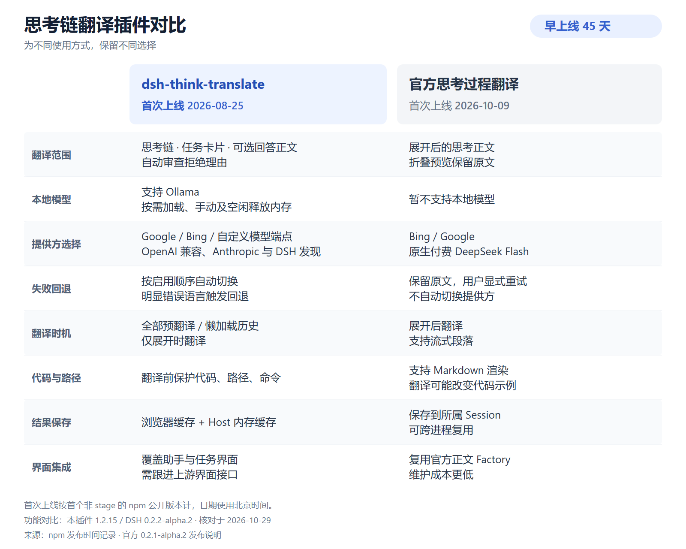

# 与官方思考过程翻译的对比

核对版本：DSH `0.2.2-alpha.2`，上游提交 `f3803c9697`，本插件 `1.2.15`。下表基于源码和包说明；官方方案没有在当前验证 profile 中启用，不将源码测试当作本机使用体验。

双方“首次上线”统一采用首个非 stage 的 npm 公开可安装版本，北京时间。我们的 `1.0.0` 发布于 2026-08-25 23:51，官方组合包 `0.2.1-alpha.2` 发布于 2026-10-09 16:09；按日期计，我们早上线 45 天。官方思考翻译源码首次提交为 2026-10-06，此处不将源码提交日与可安装版本发布日混用。精确时间和来源见 [first-release-evidence.json](first-release-evidence.json)。

| 项目 | dsh-think-translate 首次上线：2026-08-25 | 官方思考过程翻译 首次上线：2026-10-09 |
|---|---|---|
| 翻译范围 | 思考、任务卡片、输入区任务列表、可选回答正文、自动审查拒绝理由 | 展开后的思考正文；折叠预览保持原文 |
| 提供方 | 本地 Ollama、Google、Bing、自定义 OpenAI/Anthropic 端点及 DSH 提供方发现 | Bing、Google、原生付费 DeepSeek Flash（账户或 API） |
| 失败处理 | 按已启用的顺序回退；明显错误语言触发下一家；冷却后重试 | 保留原文，用户显式重试；不自动换提供方 |
| 翻译时机 | 全部预翻译、懒加载历史、仅展开时翻译 | 展开后，处理完整段落及流式长段落前缀 |
| 译文保存 | 浏览器 localStorage 和 Host 内存缓存；不写入 Session 翻译事件 | 写入所属 Session 日志，可跨进程复用 |
| 原文与模型上下文 | 原文保留，译文不进入模型上下文 | 原文保留，译文不替换原始模型输入 |
| Markdown 与代码 | 复用 Markdown 组件；翻译前保护代码、路径和命令 | 官方正文 Factory 渲染；文档明确列出翻译可能改变 Markdown/代码 |
| 本地内存管理 | 选中模型的手动释放、取消勾选后释放、空闲释放、下次翻译重载 | 没有本地模型提供方 |
| 界面集成 | 覆盖 `assistant-step`、任务卡片和任务 dock；需跟进上游界面接口 | 只包装 `conversation.chat.reasoning.body`，复用官方内容 Factory |
| 语言 | 固定 8 种目标语言及界面文案，含韩语、不含葡语 | 目标语言接受语言代码，`auto` 跟随界面；界面有中英日西法德俄葡 |

官方的优势是维护成本和 Session 级持久化。它接管思考正文扩展点，不复制完整助手渲染，因此更容易跟随上游新增的图片、引用、折叠等能力。本次适配也实际发现了我们旧图片接口失效和整轮折叠未接入的问题。

现阶段仍值得维护本插件，但应收窄方向：本地/自定义模型、提供方回退、任务与正文翻译、代码保护、模型内存管理。若只需要偶尔展开思考并用 Bing/Google/DeepSeek 翻译，官方方案更适合，没必要为这一个需求维护完整自定义助手界面。

不要同时启用两套思考翻译。本插件优先覆盖整个 `assistant-step`，官方正文扩展点不能按预期被调用；这不是叠加翻译。后续结构性优化可将本插件的思考翻译迁到官方 `conversation.chat.reasoning.body`，将正文和任务能力单独维护；本次未把这一结构调整混入兼容性修复。

来源：

- [我们的 npm 发布时间记录](https://registry.npmjs.org/dsh-think-translate) — `time["1.0.0"]`。
- [官方组合包 npm 发布时间记录](https://registry.npmjs.org/@deepseek-ai%2Fdsh-experimental-cot-translation-bundle) — `time["0.2.1-alpha.2"]`。
- [官方首次包含思考翻译的发布说明](https://github.com/deepseek-ai/deepseek-harness/releases/tag/dsh-v0.2.1-alpha.2)。
- [官方思考翻译说明](https://github.com/deepseek-ai/deepseek-harness/blob/f3803c9697/packages/experimental/client-ui-cot-translation/README.zh.md)
- [官方翻译服务说明与限制](https://github.com/deepseek-ai/deepseek-harness/blob/f3803c9697/packages/experimental/translator/README.zh.md)
- [官方提供方选项](https://github.com/deepseek-ai/deepseek-harness/blob/f3803c9697/packages/experimental/client-ui-cot-translation/src/preferences.ts)
- [官方助手渲染与图片子 Slot](https://github.com/deepseek-ai/deepseek-harness/blob/f3803c9697/packages/client/ui-chat/src/client/chat/register-node-renderers.ts)
- [Ollama 单模型驻留与释放](https://docs.ollama.com/faq#how-do-i-keep-a-model-loaded-in-memory-or-make-it-unload-immediately)
